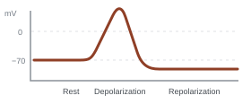
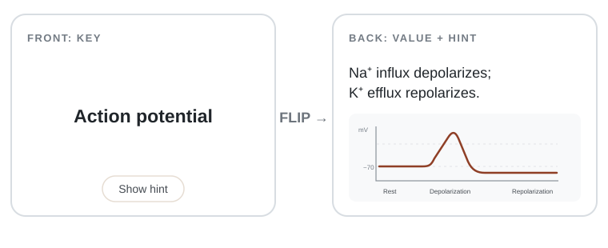
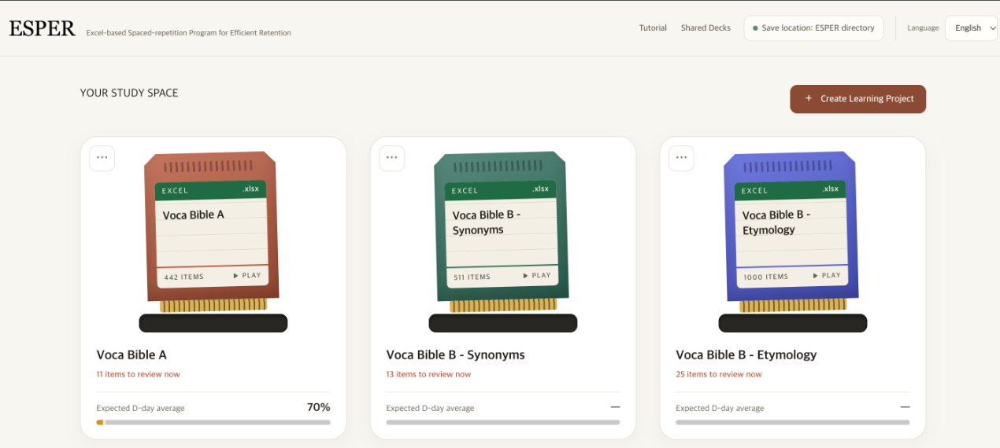
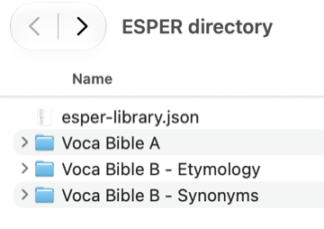
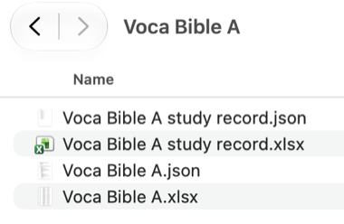

## Introduction

ESPER stands for **Excel-based Spaced-repetition Program for Efficient Retention**.<br>
It is a spaced-repetition learning tool powered by FSRS-7, designed for people who want a simpler alternative to Anki's interface.<br>
ESPER works for anything you want to memorize in a key–value format, from vocabulary and formulas to scientific concepts and historical facts.<br>
Import an existing workbook or Anki deck to get started without creating flashcards one by one.<br>
Supported imports: Excel workbooks (`.xlsx`, `.xlsm`), Anki decks (`.apkg`), and ESPER share files (`.espr`).

<br><br>

## How to use ESPER

1. **Open ESPER**<br>
   Open [ESPER](https://sunghokim128.github.io/ESPER/) in a current Chromium-based browser such as Chrome or Edge.<br>
   Choose your interface language and a folder for your projects.

2. **Import your study material**<br>
   Import an Excel workbook, Anki deck, or ESPER `.espr` file.<br>
   Anki decks are converted into ESPER workbooks.

3. **Set your study plan**<br>
   In Learning status, set your exam date and the recall level you want to reach by then.<br>
   ESPER recommends finishing your first pass at about 80% of the time remaining, leaving the final period for reviews.<br>
   Follow the recommended number of new cards per day or set your own.

4. **Study with active recall**<br>
   Try to remember the value before revealing it.<br>
   Use a hint if needed, then rate your recall **Again**, **Hard**, **Good**, or **Easy**.<br>
   FSRS-7 uses your ratings to schedule future reviews.

5. **Keep learning**<br>
   Return to your project for scheduled reviews and use Learning status to track your activity.

### Additional features

- **A4 view:** Review multiple items in a printable layout. Use **Export to PDF** to print or save it as a PDF.
- **Learning status:** Check your study log and card understanding, and update your study plan.

<br><br>

## Workbook format

ESPER uses a simple three-column format: The first row is a header, and study items start on the second row.<br>
Use this format for vocabulary, equations, scientific concepts, dates, and more.<br>
The in-app **Format Guide** can help you prepare a compatible workbook.

- **Column A — Key:** The question, term, or concept to remember.
- **Column B — Value:** The answer or information to recall.
- **Column C — Hint:** Optional supporting information.
<br>

| Key | Value | Hint |
|---|---|---|
| Action potential | Na⁺ influx depolarizes; K⁺ efflux repolarizes. |  |
<br>

During study, the **Key** appears on the front of the card. Try to recall the **Value**, then flip the card to reveal it. You can show the **Hint** when you need extra help; hints can include images.



<br><br>

## Project file structure

Choose a save folder and ESPER will organize your projects like this:

```text
chosen-folder/
├── esper-library.json
└── project-name/
    ├── study-workbook.xlsx
    ├── study-workbook.json
    ├── project-name study record.json
    └── images/  (when the workbook uses images)
```

- `study-workbook.xlsx` — The study material. Anki decks are converted to `.xlsx`; imported Excel workbooks keep their supported file extension.
- `study-workbook.json` — FSRS card states and review history, along with exam-planning settings.
- `project-name study record.json` — My Log study-session summaries.
- `images/` — Images used in the workbook.
- `esper-library.json` — Project order, colors, and user preferences. Project-list details, some settings, and save-folder permission are also kept in the browser.

These screenshots show the project list and the corresponding folders on your device:

**ESPER project list** — Each card represents a study project. The save-location indicator shows the connected folder.



**Selected save folder** — The root contains `esper-library.json` and a separate folder for each project.



**A project folder** — The workbook and FSRS data are stored together. The current My Log file is `project-name study record.json`. The `.xlsx` record shown in the screenshot is not used by the current format.



Choose where your study files are stored, and copy or move the folder yourself when you need to back it up or transfer it.<br>
Reconnect the same folder to continue your projects with their saved progress.<br>
You can use different folders as separate workspaces for different sets of projects. These workspaces may feel like separate accounts, but ESPER does not create or manage user accounts.

<br><br>

## Data storage and privacy

ESPER fetches tutorial and guide assets from its website when needed.<br>
Third-party sites are contacted only when you choose to open their links; their privacy policies apply when you visit them.

<br><br>

## Acknowledgements

ESPER uses [`ts-fsrs`](https://github.com/open-spaced-repetition/ts-fsrs) version 6.0.0 by [Open Spaced Repetition](https://github.com/open-spaced-repetition) to implement FSRS-7 scheduling.<br>
`ts-fsrs` is distributed under the MIT License. See [`vendor/ts-fsrs/LICENSE`](./vendor/ts-fsrs/LICENSE).
